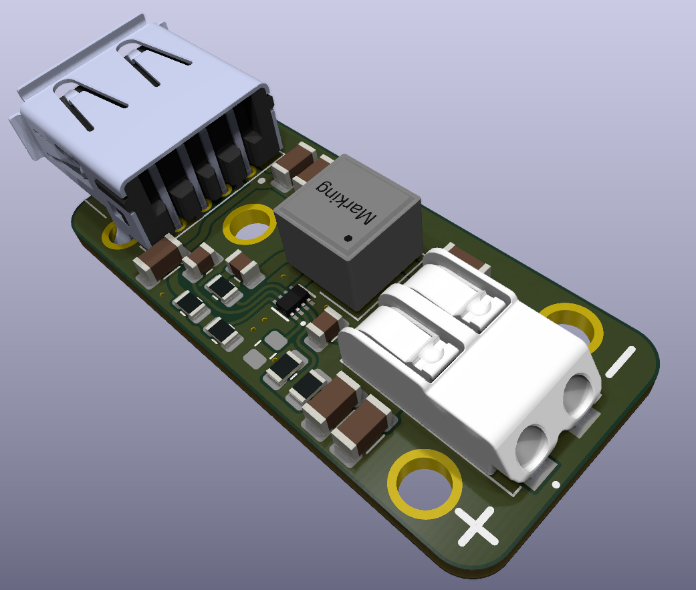
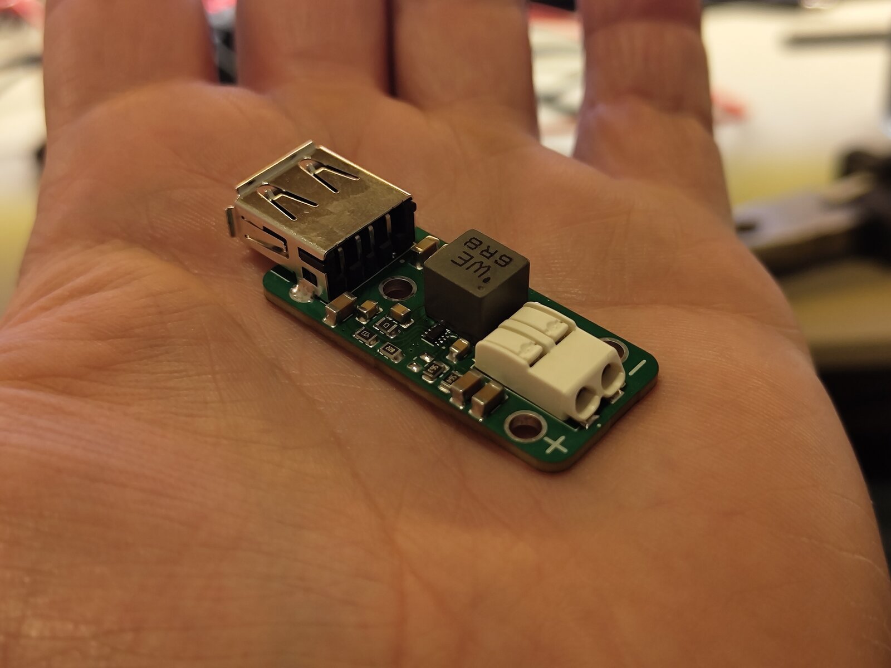
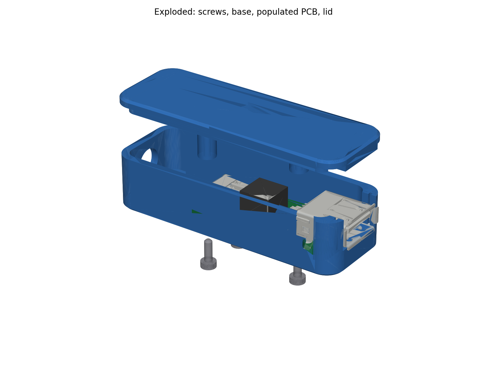
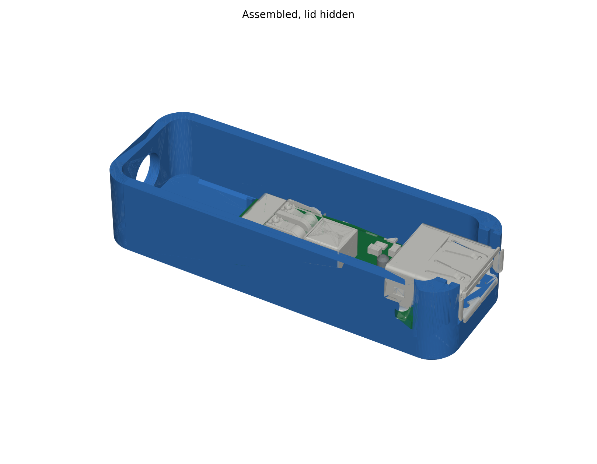
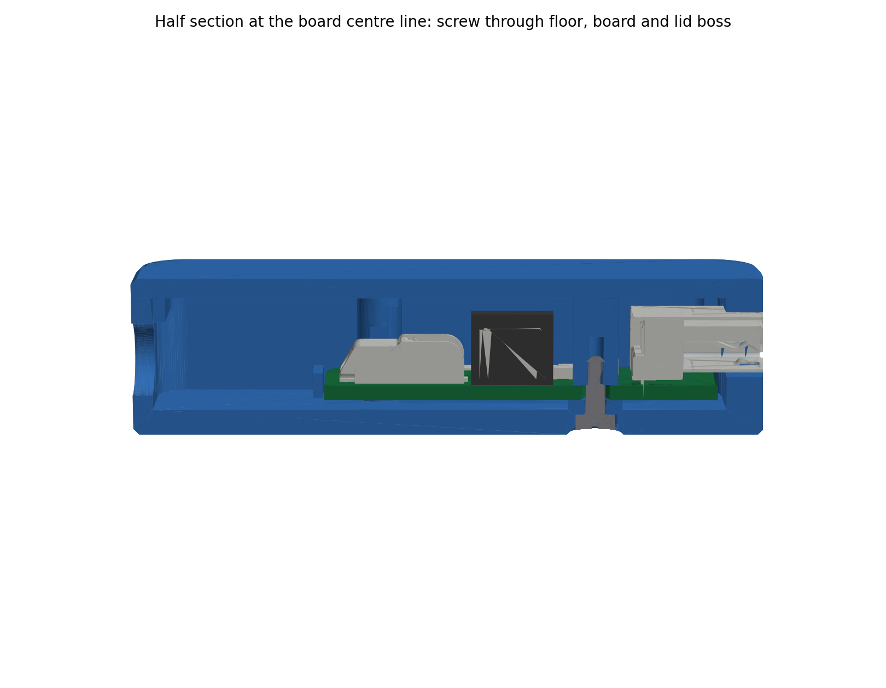

# 5 Volt Buck with UVLO

A small 12 V to 5 V USB power adapter with an adjustable under-voltage lockout (UVLO),
built around the TI **TPS62933** 3 A synchronous buck converter.

It is meant for 12 V lead-acid systems (car, boat, cabin). The 5 V output switches off
when the battery sags to roughly 12.2 V and does not come back until the battery is being
charged again (roughly 13.3 V), so the adapter cannot flatten the battery.

The KiCad project files are named `USB-Adapter`.





## Specifications (as built)

| | |
|---|---|
| Input | 12 V nominal, Wago 2060-452 push-in terminal (J1). Converter range 3.8 V to 30 V. |
| Output | 5.16 V measured, USB-A receptacle (J2, TE 292303-1). Converter limit 3 A. |
| UVLO | Off at 12.1 to 12.3 V, on again at 13.3 to 13.4 V (measured, see tuning log) |
| Switching frequency | 500 kHz. The RT pin is left floating: the R3 footprint between RT and GND is not populated. Fitting a 0 Ω there would select 1.2 MHz. |
| Efficiency | About 95 % theoretical for 12 V in, 5 V out, based on the TPS62933 datasheet efficiency curves. Not yet measured on this board. |
| Inductor | Würth 74439387068, WE-XHMI 7070, 6.8 µH |
| Soft start | C4 on the SS pin |
| Board | 40 × 18 mm, 2 layers |

## Resistor values: read this before building

**The resistor values in the schematic and in the exported BOM under `production/` are
not the values on the working boards.** The first boards were built with 5 % resistors,
which turned out to be too loose for both dividers, so the values were tuned by measuring
and swapping. The table below is the as-built, tested configuration.

| Function | Refs | As built (tested) | Schematic | `production/bom.csv` |
|---|---|---|---|---|
| UVLO divider (VIN → EN → GND) | R1 / R2 | **530 kΩ / 53 kΩ** | 330 kΩ / 33 kΩ | 511 kΩ / 88.7 kΩ |
| Output voltage (VBUS → FB → GND) | R6 / R7 | **130 kΩ / 24 kΩ** | 43 kΩ / 8.2 kΩ | 53.6 kΩ / 10.2 kΩ |

**Use 1 % resistors.** With 1 % parts the as-built values should land on target
without the tweaking described below. The 5 % parts used so far needed measuring and
testing against the specific batch.

### Output voltage (R6 / R7)

The TPS62933 regulates the FB pin to 0.8 V:

```
V_OUT = 0.8 V × (1 + R6 / R7)
130 kΩ / 24 kΩ  →  5.13 V calculated, 5.16 V measured
```

The output is deliberately a little above 5.00 V to make up for voltage drop in the
USB cable. USB allows 4.75 V to 5.25 V at the connector.

### Under-voltage lockout (R1 / R2)

The EN pin has a 1.21 V rising and 1.17 V falling threshold (typical). It also has an
internal pull-up of 0.7 µA that is always present, plus an extra 1.4 µA once the device
is enabled. That extra current is what creates the hysteresis across R1:

```
V_START ≈ 1.21 V × (R1 + R2) / R2  −  0.7 µA × R1
V_STOP  ≈ 1.17 V × (R1 + R2) / R2  −  2.1 µA × R1

530 kΩ / 53 kΩ  →  V_START ≈ 12.9 V, V_STOP ≈ 11.8 V (typical values)
```

Measured boards sit 0.3 to 0.5 V above these calculated numbers. That is consistent with
the EN threshold spread in the datasheet (rising threshold up to 1.28 V max) combined
with 5 % resistors. The hysteresis is about 1.1 V; the datasheet recommends more than
0.5 V.

**Disabling the UVLO:** leave out (or remove) R1 and R2. The EN pin then floats and the
converter's internal pull-up current enables it, so it simply runs over the chip's full
3.8 V to 30 V input range.

## Tuning log

Notes from bring-up of the first two boards, all with 5 % resistors.

### UVLO (R1 / R2)

| R1 / R2 | Cuts off at | Activates again at |
|---|---|---|
| 330 kΩ / 33 kΩ | 12.6 V | 13.4 V |
| 560 kΩ / 56 kΩ, board 1 | 12.3 V | 13.36 V |
| 560 kΩ / 56 kΩ, board 2 | 12.14 V | 13.31 V |

560 kΩ / 56 kΩ was used instead of 330 kΩ / 33 kΩ.

### Output voltage (R6 / R7)

| Try | R6 / R7 | Calculated | Measured | Note |
|---|---|---|---|---|
| 1 | 43 kΩ / 8.2 kΩ | 5.00 V | 4.88 V | Too low. |
| 2 | 56 kΩ / 10 kΩ | 5.28 V | 5.23 V | A bit much, should be lowered. |
| 3 | 82 kΩ / 15 kΩ | 5.17 V | 5.17 V | Fine. |
| 4 | 130 kΩ / 24 kΩ | 5.13 V | 5.16 V | Better. |
| 5 | 300 kΩ / 56 kΩ | 5.09 V | 5.22 V | |
| 6 | 130 kΩ / 24 kΩ | 5.13 V | 5.16 V | Went back to this. Good enough. |

The plan is to get 1 % resistors. The 5 % ones require tweaking and testing with the
specific batch.

## 3D-printed case





A two-part enclosure generated from the PCB geometry, in `case/`:

- `usb-adapter-case.step`: base and lid in print orientation (lid upside down). Also as
  `usb-adapter-case-base.stl` and `usb-adapter-case-lid.stl` for slicing.
- `usb-adapter-case-base.step` and `usb-adapter-case-lid.step`: the two parts as separate files,
  same print orientation.
- `usb-adapter-assembly.step`: the complete unit as a STEP assembly: case (base, lid, three screws)
  and the populated board, every part named by its reference designator (J1, J2, L1, U1, C1 to C11,
  R1 to R7). R3 is left out because that footprint is not populated. Open this one to see how it
  all goes together.
- `usb-adapter-case-assembled.step`: base, lid and the three screws only, in their closed positions.
- `make_case.py`: the parametric FreeCAD script that produced the files. It reads the populated
  board from `USB-Adapter.step` in the repository root (the KiCad STEP export), removes everything
  below the board bottom because the pins are cut flush, and checks every component against base
  and lid. Edit the parameter block at the top and re-run with `freecadcmd` to change clearances,
  wall thickness and so on.

| | |
|---|---|
| Outer size | 64.2 × 22.8 × 16.2 mm, 2 mm walls (3.9 mm at the USB end), 2.6 mm floor, 2 mm lid |
| Board clearance | 0.4 mm to the side walls, 1 mm standoff under the board (the through-hole pins are trimmed flush), 9 mm above the board. The two lid bosses beside the Wago are flattened on the connector side up to its height, leaving 0.45 mm. |
| Board position | After the first fit check the board was moved 0.5 mm towards the cable end relative to the box (`BOARD_DX` in the script): the three screw positions and the board stops sit 0.5 mm closer to the cable hole than the KiCad hole positions, which closes the gap between the USB flange and the end wall by the same amount. |
| USB end | U-shaped slot in the end wall; the lid carries a tab that closes the slot above the shell. The wall reaches the connector's front flange, stopping 0.3 mm short of it, so only the flange shows outside the case. The shell's side latch tabs sit in a groove inside the wall. |
| Wire end | The cavity extends 17.5 mm beyond the board edge. A single 7.5 mm hole in the end wall takes a two-core cable, its lower edge 1.5 mm above the floor. The extension is free space for a zip tie cinched on the cable: the tie is bigger than the hole, so a yank on the cable stops at the tie instead of at the Wago connection. Two low ribs stop the board sliding into the extension. |
| Fastening | Three M2 × 6 pan-head screws driven from below. Each passes through a 2.3 mm hole in the floor and pillar, through a 3 mm board hole, and self-taps into a 1.6 mm pilot hole in a boss that hangs from the lid down to the board, so the board is clamped between pillar and boss. With a 6 mm screw 2.9 mm of thread sits in the boss; a 5 mm screw would leave only 1.9 mm, so use the 6 mm ones. The heads sit in 4.6 × 2.1 mm counterbores, so the case stands flat. The lid locates with an inner lip before the screws go in. The screws are included in the assembled STEP. |



Assembly: feed the cable through the end wall, cinch a zip tie on it inside the extension,
strip the two conductors and push them into the Wago. Drop the board into the base so the USB
shell slides down into the end slot, fit the lid, and drive the three screws from underneath. Every part of the exported board (`USB-Adapter.step`, pins cut flush) was checked against base and
lid: no overlaps; the closest parts are the USB flange (0.3 mm from the end wall, by design) and
the lid bosses beside the Wago (0.45 mm). The inductor is checked as a 7070 envelope because the
KiCad model on the board is the smaller 6060 package. The first fit check showed the USB flange
sitting 0.5 mm further from the end wall than the model, so the model now places the USB shell
0.5 mm further out on the board (`USB_DX`) and the board 0.5 mm towards the cable end (`BOARD_DX`).

## Repository contents

- `USB-Adapter.kicad_pro`, `.kicad_sch`, `.kicad_pcb`: KiCad project, schematic and board.
- `USB-Adapter.step`: STEP export of the populated board from KiCad; the case script reads it.
- `schematic.pdf`: plotted schematic.
- `images/`: photo of the assembled board and a 3D render.
- `case/`: 3D-printable enclosure (STEP, STL, previews) and the FreeCAD script that generates it.
- `production/`: JLCPCB export from the Fabrication Toolkit plugin (gerber zip, BOM,
  component positions, IPC netlist). This export is from an earlier revision: besides the
  resistor values above, it lists C4 as 33 nF while the schematic has 100 nF, and it lists R3
  as 0 Ω although that footprint is left unpopulated on the boards.
- `fabrication-toolkit-options.json`: settings used for the export.
